<p align="center">
  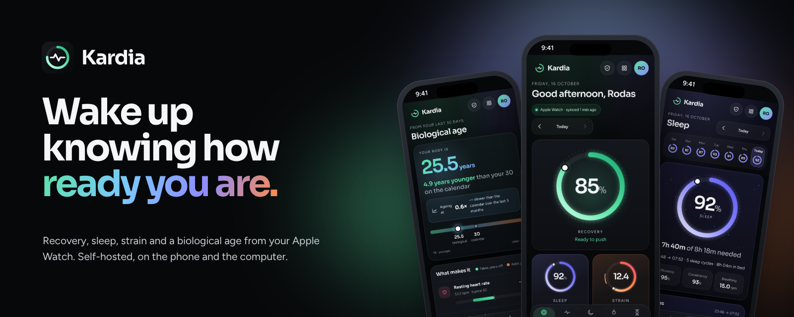
</p>

<p align="center">
  A <b>self-hosted</b> recovery coach for the <b>Apple Watch</b>: a morning <b>recovery</b> score, a <b>sleep</b> coach,<br>
  a daily <b>strain</b> target and a <b>biological age</b> you can move — on the phone and on the computer, on your own server.
</p>

<p align="center">
  
  
  
  
  
  
</p>

<p align="center">
  <a href="#features">Features</a> ·
  <a href="#screenshots">Screenshots</a> ·
  <a href="#quick-start-docker-on-the-nas">Quick start</a> ·
  <a href="#connecting-the-apple-watch">Apple Watch</a> ·
  <a href="#notifications-and-the-ai-coach">Notifications & AI</a> ·
  <a href="#how-the-scores-work">The scores</a> ·
  <a href="#development">Development</a>
</p>

<p align="center">
  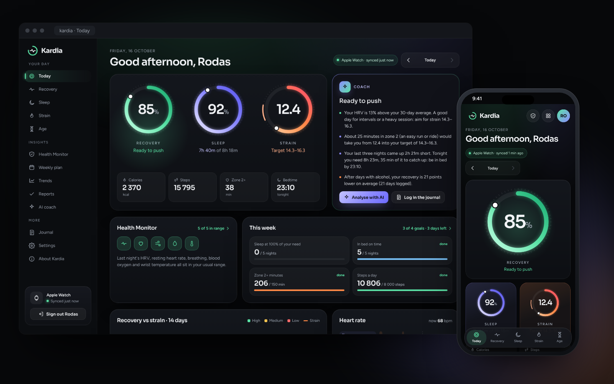
</p>

> Kardia isn't a medical device. The scores are estimates for training and sleep, not a diagnosis.

---

## Features

**Every morning**

- **Recovery, 1–99%**: last night's heart rate variability, resting heart rate, sleep, breathing and wrist temperature
  against **your own 30-day normal**. Green (67+) means push, yellow means a steady day, red means take it easy.
  The Recovery screen shows what moved it, each part against your normal, and 30 days of HRV.
- **A coach that reads the numbers**: one headline and a few lines a day — how hard to go, how much sleep you owe,
  when to be in bed, and which habit has been costing you.
- **Today on one screen**: the three rings, calories, steps, minutes in zone 2+, tonight's bedtime, the last 14 days of
  recovery against strain, the heart rate through the day, last night's stages and your vitals with sparklines.

**Sleep**

- **Stages** (awake, REM, light, deep) on a hypnogram, the number of 90-minute cycles, efficiency (asleep vs in bed)
  and consistency (how regular your bed and wake times are).
- **Sleep need that moves**: a base (7 h 30 by default, yours in Settings) plus extra after a hard day plus a part of
  the last three nights' debt. Kardia works out **when to be in bed** to wake at your usual time.

**Strain**

- **Strain, 0–21**: the load on your heart through the day (Banister TRIMP from heart rate per minute, on a curve so
  the last points are the hardest), with **five heart-rate zones** and every workout with its own strain and curve.
- **A target that follows recovery**: a green morning asks for more, a red one for less. Kardia tells you how many
  minutes in zone 2 would get you there.

**Biological age**

- **Your body against the calendar**: cardio fitness (VO₂ max), resting heart rate, HRV, sleep, sleep consistency,
  steps, time in zone 2+ and BMI, each compared with what's typical for your age and sex, each worth years up or down.
- **Pace of ageing** over the last three months (0.6× = ageing slower than the calendar), and six months of history.
- It needs two weeks of data and moves slowly on purpose: one bad week can't swing it.

**Health Monitor** (like WHOOP's)

- Last night's **HRV, resting heart rate, respiratory rate, blood oxygen and wrist temperature**, each against **your
  own typical range** (your 30-day mean ± 1.5 spreads, learnt from a week of nights): green in range, orange outside,
  red far outside. Two or more outside at once shows on Today and can send a notification.
- A **30-day or 6-month report** with every night, the range and the days outside, to **print or save as PDF** for a
  conversation with your doctor. It shows numbers, never a diagnosis.

**Cardio load** (like Bevel's)

- The last **7 days of heart load against the last 28**: detraining below 0.8, maintaining, **productive 1.0–1.3**,
  overreaching, overtraining above 1.5 — with the daily strain that keeps you productive this week and 8 weeks of history.

**Weekly plan and sleep goal** (like WHOOP's)

- Four targets for **Monday to Sunday**: nights on your sleep goal, nights **in bed on time** (within 30 minutes of
  your usual bedtime), **zone 2+ minutes** and **steps a day** — progress day by day, what it takes from here, last
  week's recap, and the targets your last four weeks suggest (one tap to take them).
- **Sleep goal Peak 100 % · Perform 85 % · Get by 70 %**: tonight's bedtime is planned for it.

**Trends and reports**

- **Trends** over 30 days, 90 days (with a 7-day average) or a year (weekly): recovery, HRV, resting heart rate, time
  asleep, sleep performance, strain, zone 2+ minutes, steps and VO₂ max.
- A **weekly and monthly performance assessment**: a 0–100 score (strain matched to recovery, sleep against need,
  consistency) — Peak, Strong, Fair or Off track — what stood out, every number against the period before, and the
  days one by one.

**Notifications**

- **Morning recovery** once last night is in, a **bedtime** reminder before tonight's bedtime, a **Health Monitor**
  alert, the **weekly and monthly report**, and (off by default) the **strain target**. Web Push from your own server,
  no third party; on iPhone add Kardia to the Home Screen first.

**AI coach** (optional)

- One tap and an AI reads your last 30 days and writes a short report: how you're doing, what went well, what to watch
  and **three things to do this week**. Bring a **Claude API key**, or run a **local model with Ollama** so nothing
  leaves your network. Only numbers are sent — never your name or account.

**Journal**

- Tap what happened yesterday — alcohol, late caffeine, screens in bed, a late meal, stretching, sauna, meditation,
  cold, magnesium, travel, stress, being sick.
- After a few weeks, **what moves your recovery**: next-morning recovery with and without each habit, from your own
  data ("after days with alcohol, your recovery is 21 points lower").

**Built to self-host**

- One `docker-compose.yml`: **SQL Server 2022 Express**, a one-shot **database deploy** (tables and stored procedures
  from a dacpac, applied again on every update), the **WebApi** and the **Website**.
- **Accounts for the house**: everyone sees only their own data; the first account (protected by a setup key) is the
  admin. Sign-ups can be closed.
- **Phone and computer**: the same pages, a tab bar on the phone and a sidebar on the computer; adds to the Home Screen
  like an app. **Dark** by default, **light** or **automatic** in Settings › Appearance.
- **Demo mode**: four months of believable sample data in memory, no SQL Server needed — to try it, or to take
  screenshots.
- **Nothing from the internet at runtime**: the fonts (Sora and Figtree) and the icons ship with the app.

## Screenshots

### Every morning
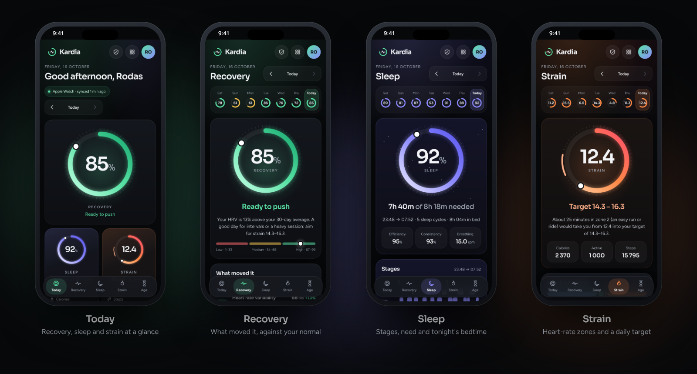

### Age, journal and settings
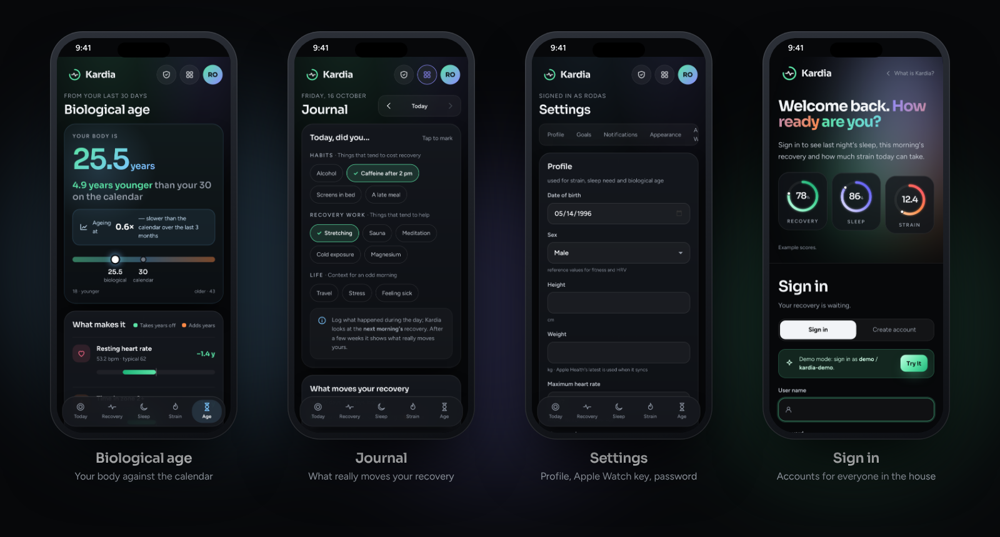

### Insights
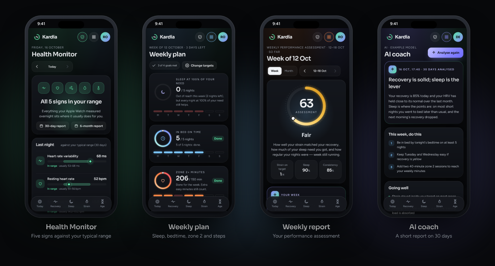

### On the computer
<table>
<tr>
<td width="50%"><b>Recovery</b><br>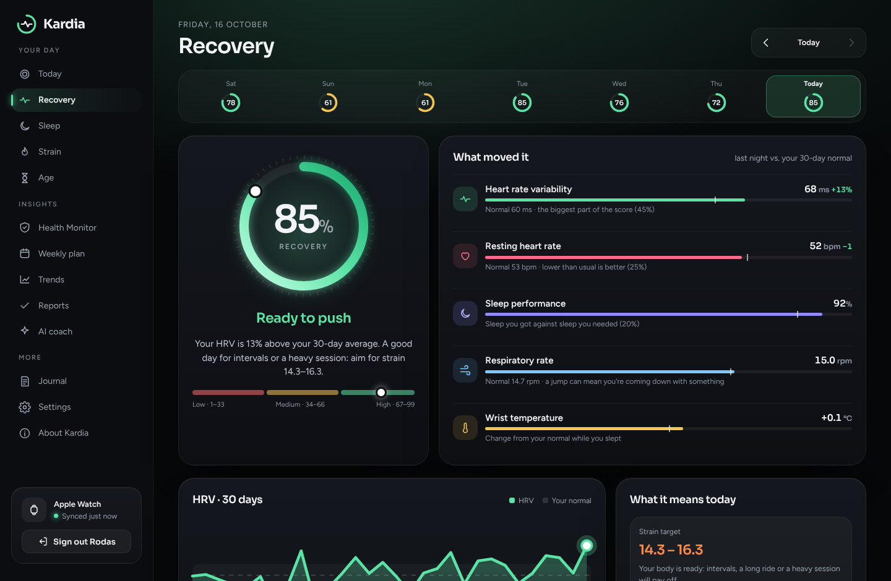</td>
<td width="50%"><b>Sleep</b><br>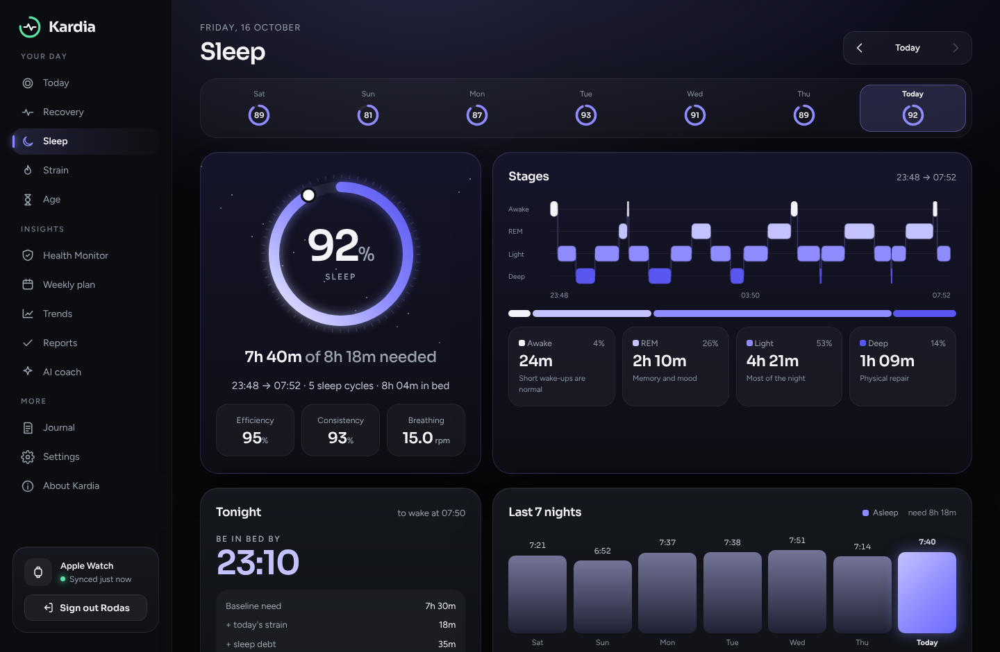</td>
</tr>
<tr>
<td width="50%"><b>Strain</b><br>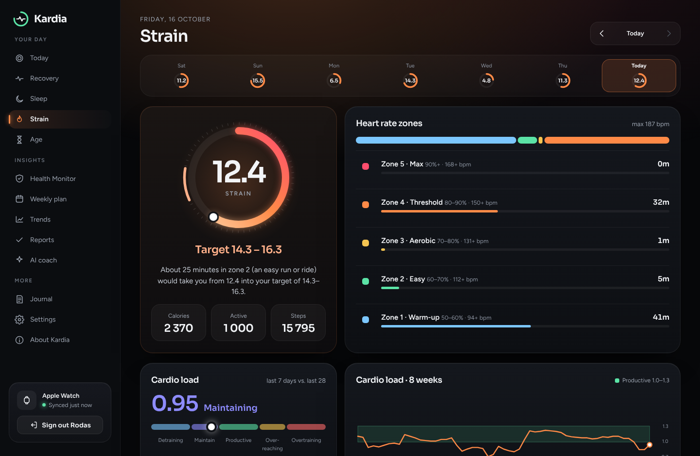</td>
<td width="50%"><b>Biological age</b><br>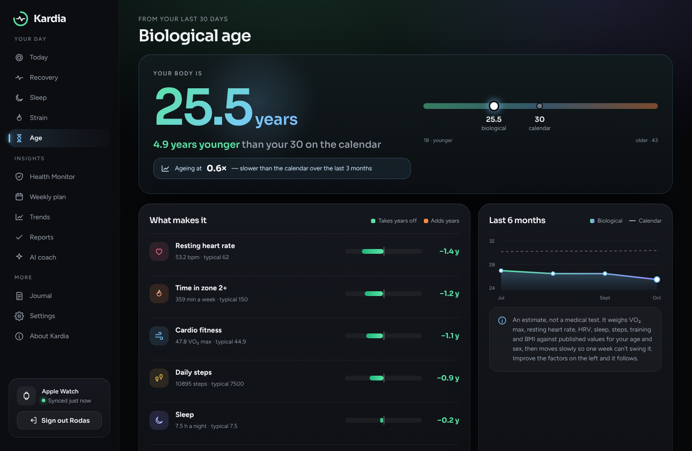</td>
</tr>
<tr>
<td width="50%"><b>Health Monitor</b><br>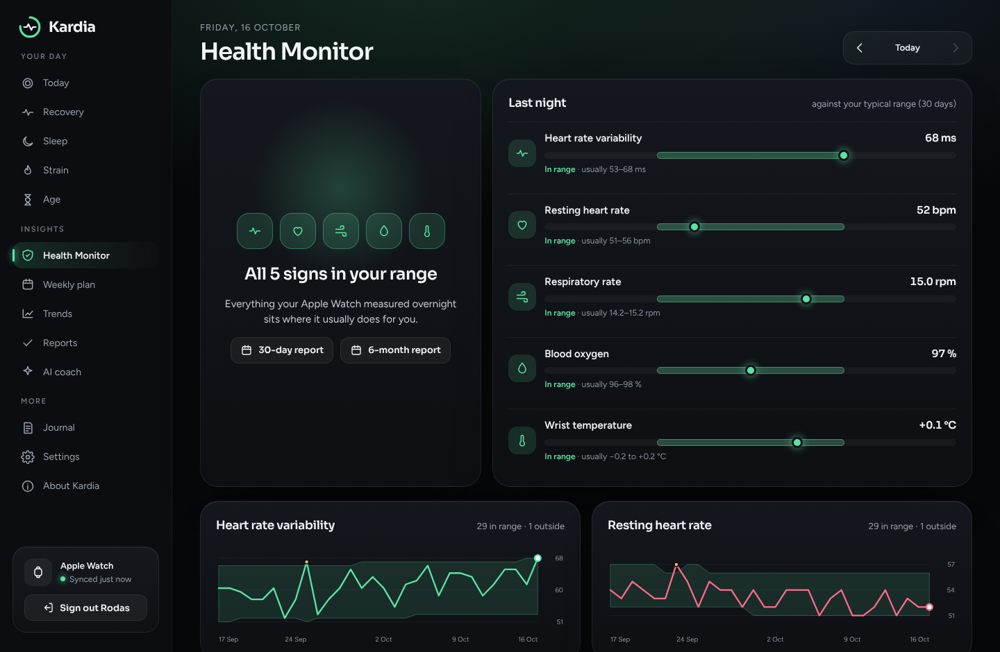</td>
<td width="50%"><b>Weekly plan</b><br>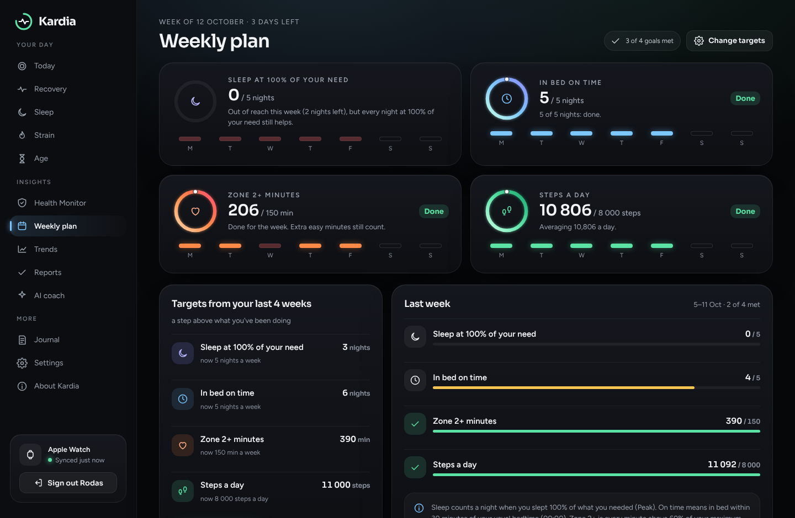</td>
</tr>
<tr>
<td width="50%"><b>Trends</b><br>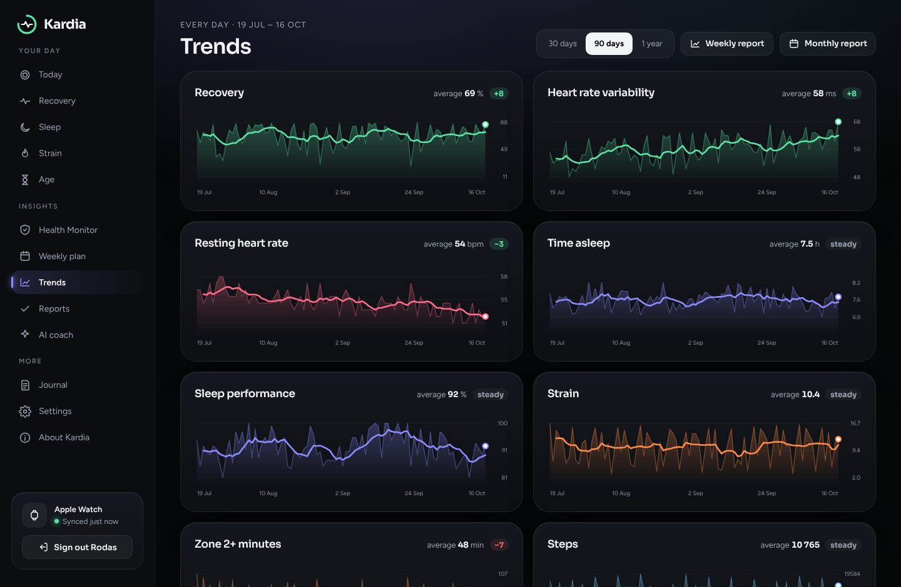</td>
<td width="50%"><b>Weekly report</b><br>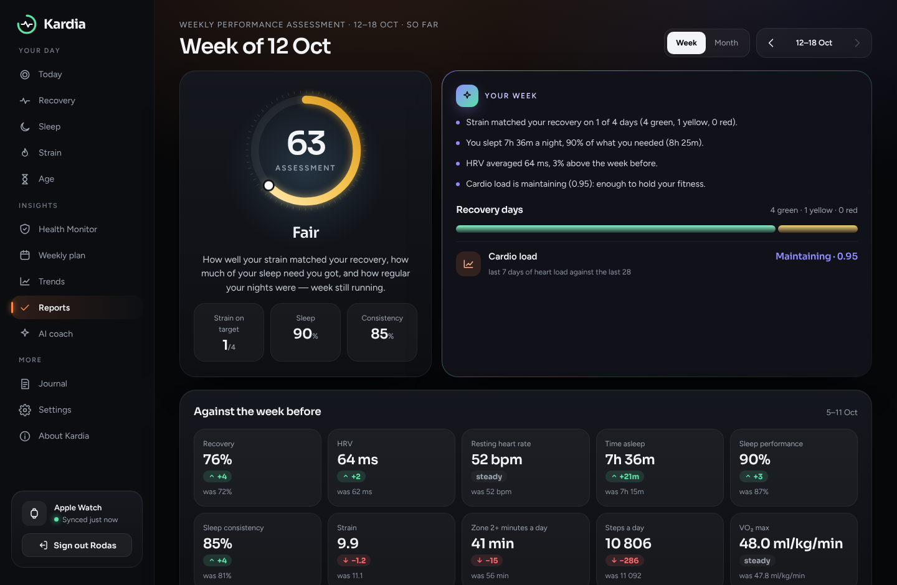</td>
</tr>
<tr>
<td width="50%"><b>AI coach</b> (an example report on the demo data)<br>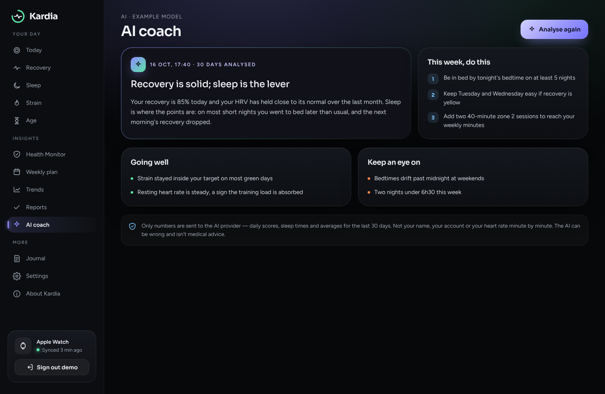</td>
<td width="50%"><b>Light theme</b><br>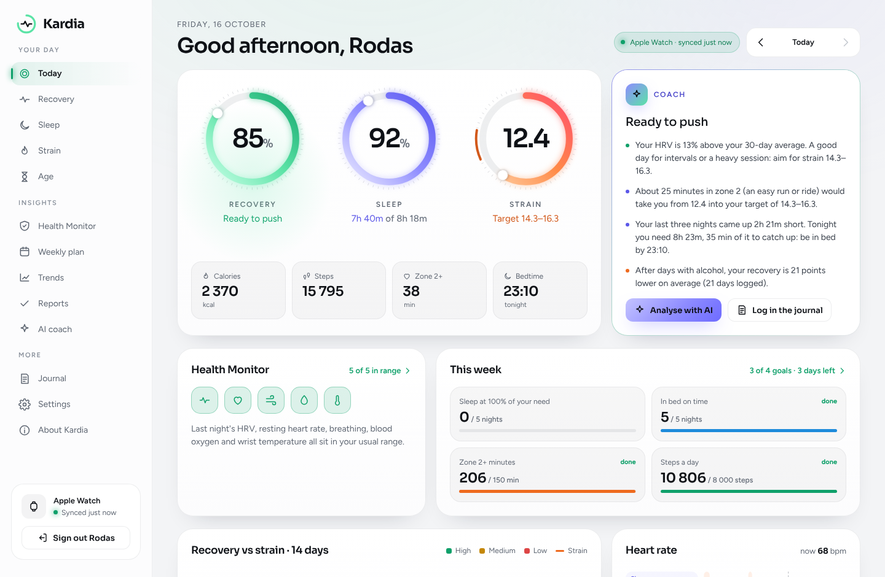</td>
</tr>
<tr>
<td width="50%"><b>Journal</b><br>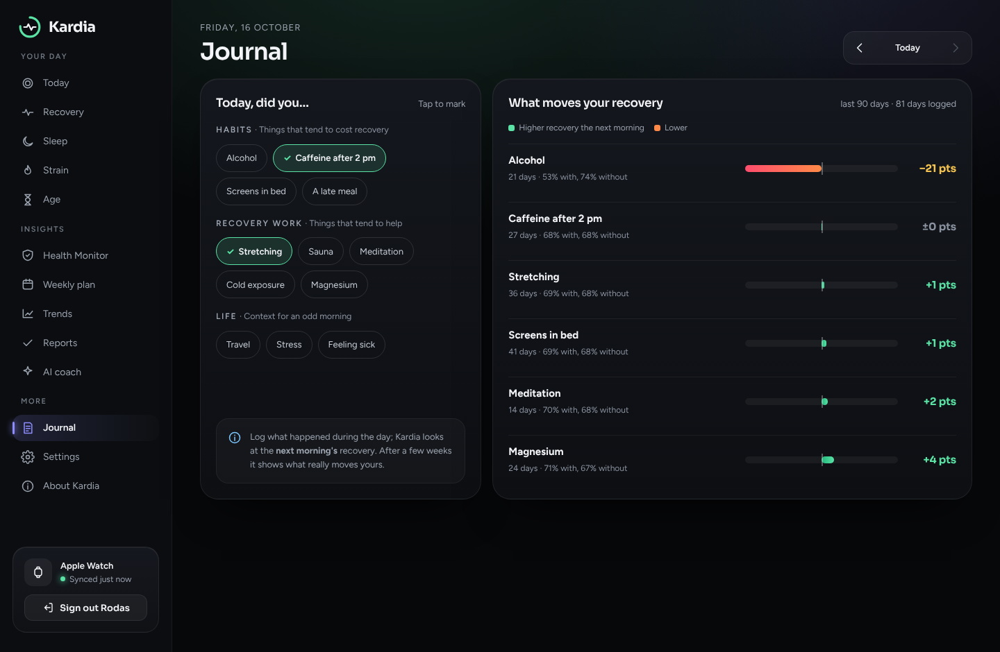</td>
<td width="50%"><b>Settings</b><br>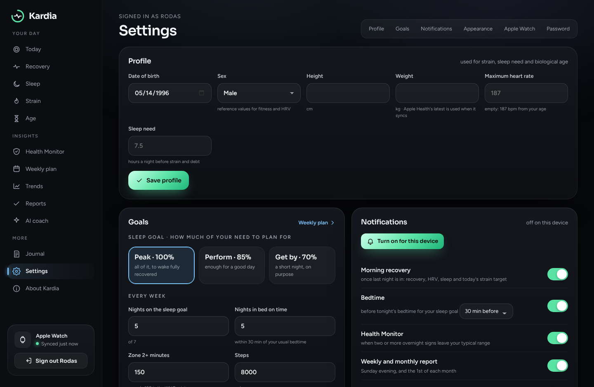</td>
</tr>
</table>

### Welcome
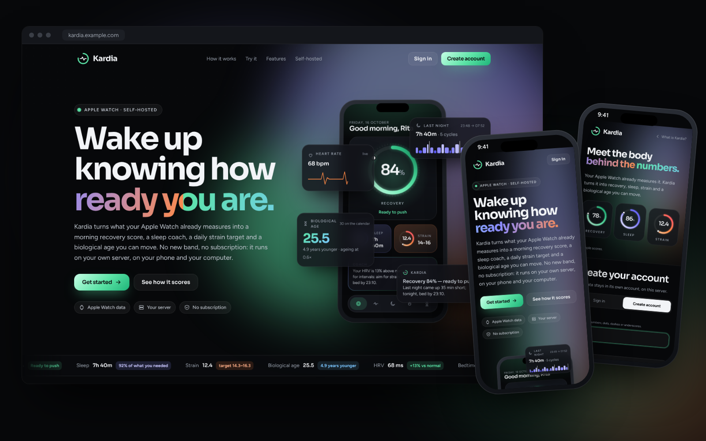

<details>
<summary>Design mocks</summary>

The first HTML mocks of the interface are in [`docs/mocks`](docs/mocks) (in Portuguese, before the app went
English); open them in a browser:

- `kardia-today-desktop.html`: Today on the computer
- `kardia-today-phone.html`, `kardia-recovery-phone.html`, `kardia-sleep-phone.html`, `kardia-strain-phone.html`: the phone
</details>

## Quick start (Docker on the NAS)

```bash
git clone https://github.com/rodrigocoelho2/Kardia.git && cd Kardia
cp .env.example .env          # then set SQL_SA_PASSWORD, KARDIA_API_KEY and KARDIA_SETUP_KEY
docker network create nas-net # once, if it doesn't exist yet
docker compose up -d --build
```

Four containers start: **kardia-sql** (SQL Server 2022 Express), **kardia-db-deploy** (publishes the database
project — creates the `Kardia` database the first time, applies schema changes on later deploys — and exits),
**kardia-webapi** (the scores; no port, only the website reaches it) and **kardia-website** (the app). Open
`http://<nas-ip>:5090`, create the first account with the setup key: it becomes the admin. Then
**Settings › Apple Watch**.

> The stack is called `kardia` whatever the folder is called, so its volumes are always `kardia_sql` and `kardia_keys`.

| Setting (`.env`) | Default | What it does |
| --- | --- | --- |
| `SQL_SA_PASSWORD` | — | SQL Server `sa` password (8+ characters, three of upper, lower, digits, symbols). |
| `KARDIA_API_KEY` | — | Internal key between the website and the WebApi (any long random string). |
| `KARDIA_SETUP_KEY` | — | Asked for only when creating the first account, so nobody else on the network can claim it. |
| `KARDIA_PUBLIC_URL` | the address you opened | Public address (e.g. `https://kardia.example.com`), shown in Settings for Health Auto Export. |
| `KARDIA_ALLOW_REGISTRATION` | `true` | `false` once everyone has an account. |
| `TIME_ZONE` | `Europe/Lisbon` | Days start at midnight here (both containers use it). |
| `KARDIA_PORT` | `5090` | Host port of the website. |
| `SQL_PORT` | `1435` | Host port for SSMS / Azure Data Studio (`<nas-ip>,1435`, user `sa`). |
| `SQL_MEMORY_LIMIT_MB` | `1024` | Keeps SQL Server from taking most of the NAS memory. |
| `SQL_CPUS` · `KARDIA_CPUS` | `2` · `1.5` | CPU cores SQL Server and each Kardia container may use, so a big Apple Watch export never takes the whole NAS. |
| `KARDIA_WEBAPI_MEMORY` · `KARDIA_WEBSITE_MEMORY` | `1g` · `512m` | Memory caps of the WebApi and the website. |
| `KARDIA_PUSH_ENABLED` | `true` | Push notifications (morning recovery, bedtime, Health Monitor, reports). Needs Kardia on HTTPS. |
| `KARDIA_PUSH_SUBJECT` | the GitHub page | A contact the push services see: `mailto:you@example.com` or your https address. |
| `KARDIA_AI_PROVIDER` | — (off) | `anthropic` (Claude) or `openai` (OpenAI, **Ollama**, LM Studio — anything OpenAI-compatible). Empty hides the AI coach. |
| `KARDIA_AI_API_KEY` | — | The provider's API key (not needed for a local Ollama). |
| `KARDIA_AI_MODEL` | `claude-haiku-5-5` · `gpt-4o-mini` | The model, e.g. `claude-sonnet-5-5` or `llama3.1:8b`. |
| `KARDIA_AI_BASE_URL` | OpenAI | For `openai`: e.g. `http://192.168.1.10:11434/v1` for Ollama on the NAS. |
| `KARDIA_AI_LANGUAGE` | `English` | The language the AI writes in, e.g. `Portuguese (Portugal)`. |
| `KARDIA_DEMO_MODE` | `false` | `true` runs on sample data in memory (sign in as `demo` / `kardia-demo`; every new account gets the data too). |

**Nginx Proxy Manager:** the website joins `nas-net`, so a proxy host can forward to `http://kardia-website:8080`
(with your wildcard certificate). Health Auto Export needs HTTPS from outside the house, so this is the address to give
it; set `KARDIA_PUBLIC_URL` to it.

**Updating:** `git pull && docker compose up -d --build`. The database deploy runs again and only applies what changed.

**Backups:** the data lives in the `kardia_sql` volume; back up the database (`BACKUP DATABASE Kardia TO DISK = …`
from SSMS) or the volume. Heart rate per minute is the biggest table (about 1 440 rows per person per day,
page-compressed).

## Connecting the Apple Watch

The watch writes everything to **Apple Health** on the iPhone; an app there sends it to Kardia. In
**Settings › Apple Watch** you'll find the address (`https://<your-kardia>/api/sync`) and a button to make your
**personal key** (shown once, revocable; only its SHA-256 is kept). Every sync is a `POST` with the key in the
`X-Kardia-Key` header (or `Authorization: Bearer …`).

### Health Auto Export (recommended)

[Health Auto Export – JSON+CSV](https://apps.apple.com/app/health-auto-export-json-csv/id1115567069) syncs in the
background; REST API automations are part of its premium plan.

1. **Automations › New automation › REST API**, the URL is your address.
2. **Headers**: `X-Kardia-Key` = your key.
3. **Export format: JSON**, **Export version: 2**, data **Health metrics** and **Workouts**, **Time grouping: Minutes**
   (so heart rate comes minute by minute).
4. Metrics: heart rate, heart rate variability, resting heart rate, respiratory rate, blood oxygen, sleep analysis,
   sleeping wrist temperature, step count, active and resting energy, VO₂ max, weight.
5. **Date range: Since last sync**, every 15–60 minutes. Run a **Manual export** of the last 30 days once to fill
   your baselines.

### The Kardia Shortcut (free)

A Shortcut can send daily values as a flat JSON dictionary — `hrv`, `restingHeartRate`, `respiratoryRate`, `steps`,
`activeEnergy`, `date` (`yyyy-MM-dd`) — with **Get Contents of URL** (POST, JSON, the same header). Shortcuts is loose
with types, so `"68 ms"` and `"14,8"` are fine. Run it from an automation after waking up and in the evening. For sleep
stages and minute heart rate (strain), use Health Auto Export.

What a sync does: values are converted to the app's time zone and metric units, a night is built from the sleep
segments (naps are skipped), a value sent again replaces the old one (totals like steps keep the larger one), and the
heart load of each touched day is worked out again. The answer says what it brought:
`1 day · 1 440 heart-rate minutes · 1 night · 1 workout · 9 daily values`.

## Notifications and the AI coach

**Notifications** are Web Push from your own server (the keys are made on first use and kept in the database). They
need Kardia on **HTTPS** — your Cloudflare / Nginx Proxy Manager address, not the IP:

- **iPhone / iPad** (iOS 16.4+): open Kardia in Safari, **Share › Add to Home Screen**, open it from the new icon, then
  **Settings › Notifications › Turn on for this device** and allow.
- **Android, Windows, Mac**: Settings › Notifications › Turn on for this device.

Choose what you get in the same card: morning recovery (once last night is in), bedtime (0–90 minutes before),
Health Monitor (two or more signs outside), the weekly report (Sunday 19:00) and the monthly one (the 1st, 10:00),
and the strain target. The server checks every five minutes and sends each one once.

The **AI coach** is off until you add a provider to `.env` and run `docker compose up -d` again:

```env
# Claude
KARDIA_AI_PROVIDER=anthropic
KARDIA_AI_API_KEY=sk-ant-...
KARDIA_AI_LANGUAGE=Portuguese (Portugal)

# …or a local model with Ollama (on the NAS or another machine)
KARDIA_AI_PROVIDER=openai
KARDIA_AI_BASE_URL=http://192.168.1.10:11434/v1
KARDIA_AI_MODEL=llama3.1:8b
```

Then **Analyse with AI** appears on Today and in the menu. What's sent: the day's scores, the last 30 days as one line
each (recovery, strain, hours asleep, bedtime, HRV, resting heart rate, steps, zone 2+ minutes), the Health Monitor, the
cardio load, the weekly plan and the weekly assessment — no name, no account, no minute-by-minute heart rate. The
report is kept until the WebApi restarts.

## How the scores work

Everything compares you with **yourself**: a baseline is the mean and spread of your last 30 days (at least 4 days;
until then, typical values for adults).

| Score | How |
| --- | --- |
| **Recovery** | z-scores against your baseline — HRV on a log scale (45%), resting heart rate (25%, lower is better), sleep performance (20%), respiratory rate (5%, only a clear change counts), wrist temperature (5%) — weighted and put through a logistic curve: `100 / (1 + e^(−1.3·(signal + 0.35)))`, 1–99. |
| **Strain** | Banister TRIMP over the day's heart rate per minute (heart-rate reserve from your resting HR to your maximum — yours, or 208 − 0.7 × age), counted from 20% of the reserve, then `21 × (1 − e^(−TRIMP/118))`. Zones 1–5 at 50/60/70/80/90% of your maximum. |
| **Strain target** | centred on `5.5 + 0.115 × recovery` (4–19), ± 1. |
| **Sleep need** | base (7 h 30 or yours) + 4 min per strain point above 8 (max 40) + a quarter of the last three nights' shortfall (max 45). |
| **Sleep** | performance = asleep / need; efficiency = asleep / in bed; consistency = 100 − 0.85 × the spread (in minutes) of your bed and wake times. Bedtime = your usual wake-up − need − 15 min to fall asleep. |
| **Biological age** | each factor adds or takes off years against the typical value for your age and sex (e.g. VO₂ max: 0.45 years per ml/kg/min, up to ±5), the total is damped (× 0.85) and capped at ±12 years. Pace compares now with 90 days ago. |
| **Health Monitor** | each sign against your last 30 days: mean ± 1.5 standard deviations is your typical range (blood oxygen only counts when low); beyond 2.5 is far outside. Needs 7 nights of your own values. |
| **Cardio load** | mean daily TRIMP of the last 7 days ÷ that of the last 28 (needs 21 days with heart rate). Productive strain = the strain of 1.0–1.3 × your 28-day daily load. |
| **Weekly plan** | Monday to Sunday. Sleep: asleep ≥ goal % × the night's need. On time: in bed within 30 min of the median bedtime of the 14 nights before. Suggested targets: your last four weeks, one step up. |
| **Assessment** | 40 % strain on target (within the day's target ± 1, finished days), 40 % sleep performance, 20 % sleep consistency. 85+ Peak, 70+ Strong, 55+ Fair. |
| **Journal** | mean next-morning recovery after days with a habit vs without, once there are at least 3 of each in the last 90 days. |

The formulas live in `Kardia.WebApi/Features/Days/Services/Scoring` and `Features/Ages/Services/BiologicalAge.cs`,
each with its unit tests.

## Development

### Solution layout

```
Kardia.slnx
├── Kardia.Database/           SQL Server project (SDK-style .sqlproj → dacpac)
│   ├── Tables/                User, UserProfile, UserSetting, SyncKey, DailyMetric, HeartRateMinute, SleepNight, Workout,
│   │                          DayLoad, JournalEntry, PushSubscription, PushSent, AppSecret
│   ├── StoredProcedures/      Users, Profiles, Settings, Syncs, Health, Journals, Push — the only way the WebApi touches data
│   └── Scripts/               post-deployment script and deploy.sh (used by the db-deploy container)
├── Kardia.Library/            enums, ServiceApiResponse, validation types, header names (no ASP.NET)
├── Kardia.WebApi/             ASP.NET Core API (x-api-key): the scores and the data
│   ├── Extensions/            API-key authentication, data (Dapper over stored procedures, memory store), time, messages
│   └── Features/              Users, Profiles, Settings, Syncs, Days, Ages, Journals, Plans, Reports, Push, AiCoach, Demo, Health
│       └── <Feature>/         Controllers, Models (Entities, DTOs), Repositories (SQL + memory), Services, Http samples
├── Kardia.Sdk/                typed client of the WebApi and copies of its DTOs (the Website never references the WebApi)
├── Kardia.Website/            ASP.NET Core MVC: the landing page, sign-in, the app, and /api/sync for the iPhone
│   ├── Controllers/           thin: fill the shell, call the model, return the view
│   ├── Model/                 page models that call the Sdk
│   ├── Helpers/               SVG charts (rings, hypnogram, heart rate, trends), icons, formatting, the clock
│   ├── Views/                 Razor views, one folder per screen
│   └── wwwroot/               css/app.css (the app) and css/public.css (landing, sign-in), js, fonts, icons
├── Kardia.UnitTest/           xUnit: scores, the Apple Health parser, the services on the demo data, the Sdk contract
└── docs/                      README images and the HTML mocks
```

WebApi controllers only map HTTP to services; services hold the rules and answer with `ServiceApiResponse<T>`;
repositories only call stored procedures. The Website's controllers stay thin and its models call the WebApi through
`Kardia.Sdk`. All user-facing text is English.

### Running it on the PC

- Visual Studio (or `dotnet`) with the .NET 10 SDK. Start **Kardia.WebApi** (`http://localhost:5091`, Swagger at
  `/swagger`) and **Kardia.Website** (`http://localhost:5090`) together (multiple startup projects).
- No SQL Server? Copy `Kardia.WebApi/appsettings.Development.json.example` to `appsettings.Development.json` with
  `"DemoMode": true` and sign in as `demo` / `kardia-demo`.
- With SQL Server: `docker compose up -d sqlserver db-deploy`, then the connection string in
  `appsettings.Development.json` (`Server=localhost,1435;Database=Kardia;…`).
- Both projects need the same API key (`Kardia:ApiKey` in the WebApi, `KardiaApi:ApiKey` in the Website):
  `Kardia.Website/appsettings.Development.json.example` has the matching one (user secrets work too).
- `Kardia.WebApi/Features/*/Http/*.http` have a request for every endpoint, including sample Health Auto Export and
  Shortcut payloads.

### Tests

```bash
dotnet test Kardia.UnitTest
```

GitHub Actions (`.github/workflows/ci.yml`) builds everything, publishes the dacpac to SQL Server twice (the second
publish must change nothing) and runs the tests; then it starts the Compose stack, smoke-tests it, creates the first
account with the setup key, makes an Apple Watch key, posts a Health Auto Export payload through `/api/sync` into SQL
Server and screenshots every page (also on the demo data). Logs and screenshots are pushed to the `ci-output-build`
and `ci-output-compose` branches.

### API (Kardia.WebApi)

JSON, every call with the `x-api-key` header. `userId` is the account's id (32 hex characters).

| | |
| --- | --- |
| `GET user/status`, `GET user/list`, `GET user?identifier=`, `POST user`, `POST user/signin`, `POST user/password`, `DELETE user?identifier=` | accounts |
| `GET profile?userId=`, `POST profile` | birth date, sex, height, weight, maximum heart rate, sleep need |
| `GET day?userId=&date=`, `GET day/range?userId=&from=&to=` | a day (recovery, sleep, strain, heart rate, coach), or a summary per day |
| `GET age?userId=` | biological age, factors, pace and history |
| `GET journal?userId=&date=`, `POST journal` | habits of a day and what they do to recovery |
| `GET`/`POST`/`DELETE sync/key?userId=`, `POST sync/ingest` | the Apple Watch key; what the Website forwards from `/api/sync` (with `X-Kardia-Key`) |
| `GET day/health?userId=&days=30\|180` | the Health Monitor over 30 days or 6 months |
| `GET`/`POST setting` | goals (sleep goal, weekly targets) and notification choices |
| `GET plan?userId=` | this week's plan |
| `GET report?userId=&period=Week\|Month&date=` | weekly or monthly assessment |
| `GET push?userId=`, `POST push/subscribe`, `POST push/unsubscribe`, `POST push/test?userId=` | notification devices |
| `GET aicoach?userId=`, `POST aicoach/analyse?userId=` | the AI coach (runs in the background; poll GET) |
| `GET health` | status (no key needed) |

## Licences

Fonts: Sora and Figtree, SIL Open Font License (`Kardia.Website/wwwroot/fonts`).
Not affiliated with Apple, WHOOP or Bevel; Apple Watch and Apple Health are trademarks of Apple Inc.
